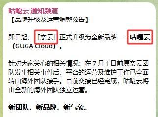
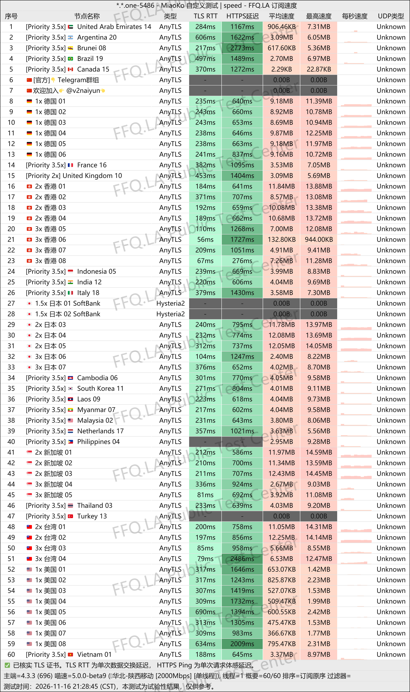
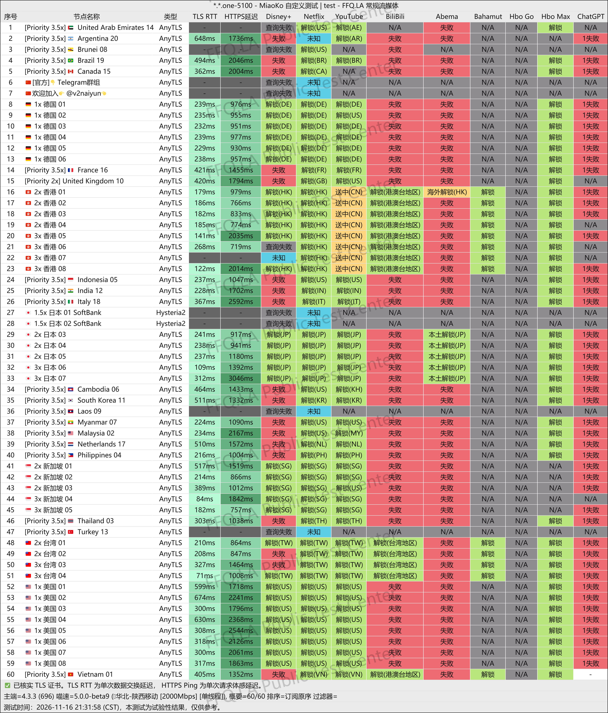
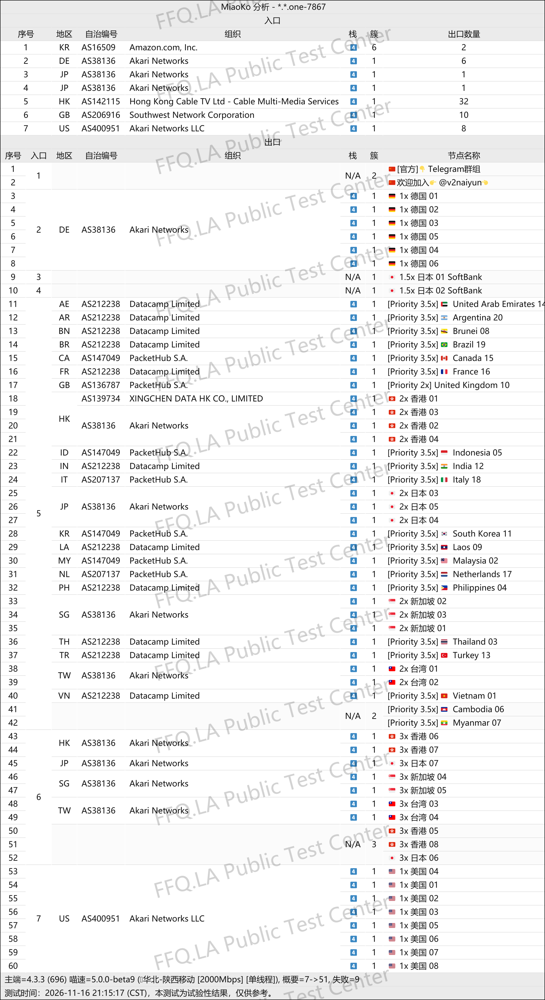

🇨🇳 中文 | 🇺🇸 [English](README_EN.md) | 🇷🇺 
[Русский](README_RU.md) | 🇮🇷 [فارسی](README_FA.md)

# GugaCloud咕嘎云机场官方地址(2026年11月19日更新)
GugaCloud咕嘎云机场官网地址</br>
`NaiYun奈云机场进行品牌升级，现改名为GugaCloud咕嘎云`

最新地址01：[user.guga.cloud](https://to.iix.im/gu01)</br>
最新地址02：[user.gugavpn.com](https://to.iix.im/gu02)</br>
官网地址01：[user.gugayun.com](https://to.iix.im/gu03)</br>
官网地址02：[user.gugavpn.one](https://to.iix.im/gu04)</br>
永久地址：[guga.cloud](https://guga.cloud)</br>

## 公告

---



---


2026最新好用的机场推荐与节点分享：[https://github.com/jdnei/JiChangTuiJian](https://github.com/jdnei/JiChangTuiJian)</br>
## Telegram VPN 机场福利社 #AD
[机场抽奖群](https://331024.de/archives/choujiang)｜[机场聊天群](https://331024.de/archives/choujiang)｜[机场体验群](https://331024.de/archives/choujiang)</br>

[https://331024.de/archives/choujiang](https://331024.de/archives/choujiang)

## 邀请码
`此邀请码注册用户可免费领取10天/50GB套餐(此活动官方随时取消)`
```bash
QPB5cCmr
```
## 折扣码/优惠码
`7折，截止日期：11.16`</br>
`新户首单年费可用一次折扣码，可~~168元/年~~，XX元/年，优惠购买一年使用时间。`
```bash
2026DOUBLE11
```  

## 简介
咕嘎云（GugaCloud）机场是一家主打高速专线网络的机场服务商，采用自有机房及全球多地接入点，提供低延迟、高带宽的跨境网络加速服务。支持Windows、macOS、iOS、Android等主流平台，提供月度流量重置及不限时流量套餐，适合日常上网、高清视频、AI工具、跨境办公及多设备用户使用。
## 优势
咕嘎云（GugaCloud）机场主打专线传输与高带宽网络，商家标称峰值速率最高5000Mbps，支持Netflix、Disney+、ChatGPT等流媒体及AI服务。套餐涵盖168GB至788GB月流量，支持5至15台设备同时在线，另有不限时流量包。年付套餐价格相对实惠，兼顾轻度使用、家庭共享及重度下载需求。

## 套餐
| 套餐             | 流量        | 价格                    | 付款周期       | 同时在线设备 | 速率             | 线路类型            | 流媒体 / AI 解锁               | 特色 / 备注                     |
| -------------- | --------- | --------------------- | ---------- | ------ | -------------- | --------------- | ------------------------- | --------------------------- |
| Basic 基础套餐（特惠） | 168GB / 月 | ¥168 / 年（约¥14/月）      | 年付，每月订单日重置 | 5 台    | 不限速，峰值5000Mbps | 专线网络、自有机房、全球接入点 | Netflix、Disney+、ChatGPT 等 | 最畅销；全平台支持；一人一号，禁止公开分享       |
| Pro 进阶套餐       | 388GB / 月 | ¥387.60 / 年（¥32.30/月） | 年付，每月订单日重置 | 10 台   | 不限速，峰值5000Mbps | 专线网络、自有机房、全球接入点 | Netflix、Disney+、ChatGPT 等 | 全平台支持；适合多设备及中高流量使用；禁止公开分享账号 |
| Max 专业套餐       | 788GB / 月 | ¥591.60 / 年（¥49.30/月） | 年付，每月订单日重置 | 15 台   | 不限速，峰值5000Mbps | 专线网络、自有机房、全球接入点 | Netflix、Disney+、ChatGPT 等 | 全平台支持；适合重度用户；禁止公开分享账号       |
| 280G 按量计费      | 280GB（总量） | ¥138                  | 一次性 / 不限时  | 5 台    | 不限速，峰值5000Mbps | 专线网络、自有机房、全球接入点 | Netflix、Disney+、ChatGPT 等 | 流量用完为止；多次购买无法叠加流量；禁止公开分享账号  |
| 680G 按量计费      | 680GB（总量） | ¥258                  | 一次性 / 不限时  | 5 台    | 不限速，峰值5000Mbps | 专线网络、自有机房、全球接入点 | Netflix、Disney+、ChatGPT 等 | 流量用完为止；多次购买无法叠加流量；禁止公开分享账号  |

### 套餐说明

- **流量重置：** Basic、Pro、Max 套餐每月订单日自动重置流量。
- **不限时流量包：** 280G 和 680G 为一次性购买，流量用完为止，多次购买无法叠加流量。
- **网络线路：** 所有套餐均支持专线网络，商家标称峰值速率最高5000Mbps。
- **设备限制：** Basic支持5台、Pro支持10台、Max支持15台、按量计费套餐支持5台同时在线。
- **流媒体与AI：** 商家标注支持Netflix、Disney+、ChatGPT等服务。
- **账号规则：** 一人一号，禁止公开分享账号。

**注意：** Basic 套餐年付 ¥168，实际折合 ¥14/月，与网页标注的 ¥13.81/月不一致，表格采用正确折算金额。

## 📊 性能实测与分析  
#### 1.晚高峰测速表现  
  
#### 2.流媒体解锁报告  
    
#### 3.落地入口分析  

