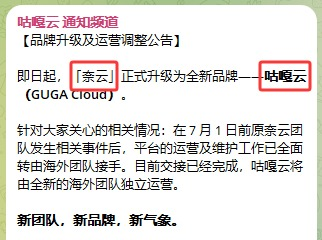

🇨🇳 [中文](README.md) | 🇺🇸 English | 🇷🇺 [Русский](README_RU.md) | 🇮🇷 [فارسی](README_FA.md)

# GugaCloud VPN Official Website (Updated November 6, 2026)

GugaCloud VPN Official Website<br>

`NaiYun VPN has undergone a brand upgrade and is now officially known as GugaCloud.`

Latest Address 01: [user.guga.cloud](https://to.iix.im/gu01)<br>
Latest Address 02: [user.gugavpn.com](https://to.iix.im/gu02)<br>
Official Website 01: [user.gugayun.com](https://to.iix.im/gu03)<br>
Official Website 02: [user.gugavpn.one](https://to.iix.im/gu04)<br>
Permanent Website: [guga.cloud](https://guga.cloud)<br>

## Announcement

---



---

2026 Best VPN Recommendations and Proxy Node Sharing: [https://github.com/jdnei/JiChangTuiJian](https://github.com/jdnei/JiChangTuiJian)<br>

## Telegram VPN Community #AD

[VPN Giveaway Group](https://331024.de/archives/choujiang) | [VPN Chat Group](https://331024.de/archives/choujiang) | [VPN Trial Group](https://331024.de/archives/choujiang)<br>

[https://331024.de/archives/choujiang](https://331024.de/archives/choujiang)

## Introduction

GugaCloud is a professional network optimization service featuring 86 global ~~access points and residential broadband IP nodes in the [United States](https://github.com/jdnei/naiyun#1%E7%BE%8E%E5%9B%BD), [Hong Kong](https://github.com/jdnei/naiyun#2%E9%A6%99%E6%B8%AF), [Taiwan](https://github.com/jdnei/naiyun#3%E5%8F%B0%E6%B9%BE), [Japan](https://github.com/jdnei/naiyun#4%E6%97%A5%E6%9C%AC), [South Korea](https://github.com/jdnei/naiyun#5%E9%9F%A9%E5%9B%BD), and Malaysia~~.

The service is designed to provide stable network acceleration for international remote work, overseas academic research, and streaming entertainment.

## Invitation Code

`Register with this invitation code to claim a free 10-day / 50 GB trial plan.`

```bash
QPB5cCmr
```

## Coupon Code / Discount Code

`30% OFF all plans during the Mid-Autumn Festival and National Day promotional period.`

```bash
MIDAUTUMN2026
```

After the free trial period ends, new customers can use a one-time discount code on their first annual subscription.

The annual subscription price is listed as ~~¥168/year~~, ¥XX/year after the promotional discount, providing one year of service at a reduced price.


## Subscription Plans

| Plan | Price | Billing Cycle | Monthly / Total Traffic | Validity | Devices | Maximum Speed | Dedicated Lines | Streaming Unblocking | Dedicated Data Center Resources | Account Sharing | Notes |
|---|---|---|---|---|---|---|---|---|---|---|---|
| Basic (Special Offer) | ¥168.00 | Annually | 168 GB | 1 year | 5 | 5000 Mbps | Available | Supported | Included | Not allowed | Traffic resets automatically on the purchase anniversary date |
| Pro | ¥32.30 | Monthly | 388 GB | 1 month | 5 | 5000 Mbps | Available | Supported | Included | Not allowed | Traffic resets automatically on the purchase anniversary date |
| Max | ¥49.30 | Monthly | 788 GB | 1 month | 5 | 5000 Mbps | Available | Supported | Included | Not allowed | Traffic resets automatically on the purchase anniversary date |
| 280 GB Pay-As-You-Go | ¥138.00 | One-time | 280 GB | No expiration | 5 | 5000 Mbps | Available | Supported | Included | Not allowed | Valid until the traffic is exhausted; multiple purchases cannot be combined |
| 680 GB Pay-As-You-Go | ¥258.00 | One-time | 680 GB | No expiration | 5 | 5000 Mbps | Available | Supported | Included | Not allowed | Valid until the traffic is exhausted; multiple purchases cannot be combined |

## Advantages

**Global Coverage:** GugaCloud operates 86 global Points of Presence (PoPs), covering Southeast Asia, Europe, North America, and some less commonly available regions.<br>

**Enterprise-Grade Network:** Uses Global Accelerator international dedicated-line technology, with SLA-backed high availability across its network nodes.<br>

**Ultra-HD Streaming Support:** Optimized for efficient 4K/8K streaming transmission with very low latency.<br>

## 📊 Performance Tests and Analysis

#### 1. Evening Peak-Hour Speed Test


#### 2. Streaming Platform Unblocking Report


#### 3. Entry and Exit Node Analysis


#### 4. Residential IP Reputation and Purity Analysis

##### 4.1 United States


##### 4.2 Hong Kong


##### 4.3 Taiwan


##### 4.4 Japan


##### 4.5 South Korea


