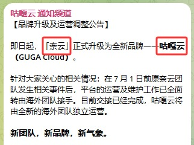

 🇨🇳 [中文](README.md) | 🇺🇸 [English](README_EN.md) | 🇷🇺 [Русский](README_RU.md) | 🇮🇷 فارسی

# وب‌سایت رسمی فیلترشکن GugaCloud(به‌روزرسانی 11 نوامبر 2026)
وب‌سایت رسمی فیلترشکن GugaCloud<br>

`سرویس NaiYun پس از تغییر و ارتقای برند، اکنون با نام GugaCloud فعالیت می‌کند.`

جدیدترین آدرس ۰۱: [user.guga.cloud](https://to.iix.im/gu01)<br>
جدیدترین آدرس ۰۲: [user.gugavpn.com](https://to.iix.im/gu02)<br>
وب‌سایت رسمی ۰۱: [user.gugayun.com](https://to.iix.im/gu03)<br>
وب‌سایت رسمی ۰۲: [user.gugavpn.one](https://to.iix.im/gu04)<br>
آدرس دائمی: [guga.cloud](https://guga.cloud)<br>

## اطلاعیه رسمی

---



---

معرفی بهترین سرویس‌های VPN و اشتراک‌گذاری سرورهای پروکسی در سال ۲۰۲۶: [https://github.com/jdnei/JiChangTuiJian](https://github.com/jdnei/JiChangTuiJian)<br>

## انجمن تلگرامی VPN #AD

[گروه قرعه‌کشی VPN](https://331024.de/archives/choujiang) | [گروه گفت‌وگوی VPN](https://331024.de/archives/choujiang) | [گروه تست VPN](https://331024.de/archives/choujiang)<br>

[https://331024.de/archives/choujiang](https://331024.de/archives/choujiang)

## معرفی

GugaCloud یک سرویس حرفه‌ای بهینه‌سازی مسیرهای شبکه است که دارای ۸۶ ~~نقطه دسترسی جهانی و سرورهای دارای IP اینترنت خانگی در [ایالات متحده](https://github.com/jdnei/naiyun#1%E7%BE%8E%E5%9B%BD)، [هنگ‌کنگ](https://github.com/jdnei/naiyun#2%E9%A6%99%E6%B8%AF)، [تایوان](https://github.com/jdnei/naiyun#3%E5%8F%B0%E6%B9%BE)، [ژاپن](https://github.com/jdnei/naiyun#4%E6%97%A5%E6%9C%AC)، [کره جنوبی](https://github.com/jdnei/naiyun#5%E9%9F%A9%E5%9B%BD) و مالزی~~ است.

هدف این سرویس، ارائه اتصال پایدار و پرسرعت برای دورکاری بین‌المللی، جست‌وجو و تحقیقات دانشگاهی در منابع خارجی و تماشای محتوای سرگرمی آنلاین است.

## کد دعوت

`با ثبت‌نام از طریق این کد دعوت، می‌توانید یک اشتراک آزمایشی رایگان ۱۰ روزه با ۵۰ گیگابایت ترافیک دریافت کنید.`

```bash
QPB5cCmr
```

## کد تخفیف

`۳۰٪ تخفیف برای تمام طرح‌ها در طول جشنواره تبلیغاتی نیمه پاییز و روز ملی چین.`

```bash
MIDAUTUMN2026
```

پس از پایان دوره آزمایشی رایگان، کاربران جدید می‌توانند هنگام خرید اولین اشتراک سالانه خود، یک بار از کد تخفیف استفاده کنند.

قیمت اشتراک سالانه به‌صورت ~~¥168 در سال~~ و پس از تخفیف به‌صورت ¥XX در سال درج شده است. این پیشنهاد امکان خرید یک سال خدمات با قیمت کاهش‌یافته را فراهم می‌کند.


## طرح‌های اشتراک

| نام طرح | قیمت | دوره پرداخت | ترافیک ماهانه / کل ترافیک | مدت اعتبار | تعداد دستگاه | حداکثر سرعت | خطوط اختصاصی | رفع محدودیت پخش آنلاین | منابع اختصاصی مرکز داده | اشتراک‌گذاری حساب | توضیحات |
|---|---|---|---|---|---|---|---|---|---|---|---|
| Basic / پایه (پیشنهاد ویژه) | ¥168.00 | سالانه | 168 گیگابایت | ۱ سال | ۵ دستگاه | 5000 مگابیت بر ثانیه | قابل استفاده | پشتیبانی می‌شود | دارد | ممنوع | ترافیک در تاریخ سفارش به‌صورت خودکار بازنشانی می‌شود |
| Pro / پیشرفته | ¥32.30 | ماهانه | 388 گیگابایت | ۱ ماه | ۵ دستگاه | 5000 مگابیت بر ثانیه | قابل استفاده | پشتیبانی می‌شود | دارد | ممنوع | ترافیک در تاریخ سفارش به‌صورت خودکار بازنشانی می‌شود |
| Max / حرفه‌ای | ¥49.30 | ماهانه | 788 گیگابایت | ۱ ماه | ۵ دستگاه | 5000 مگابیت بر ثانیه | قابل استفاده | پشتیبانی می‌شود | دارد | ممنوع | ترافیک در تاریخ سفارش به‌صورت خودکار بازنشانی می‌شود |
| بسته 280 گیگابایتی با پرداخت بر اساس مصرف | ¥138.00 | یک‌بار پرداخت | 280 گیگابایت | بدون محدودیت زمانی | ۵ دستگاه | 5000 مگابیت بر ثانیه | قابل استفاده | پشتیبانی می‌شود | دارد | ممنوع | تا پایان حجم ترافیک معتبر است؛ خریدهای متعدد با یکدیگر تجمیع نمی‌شوند |
| بسته 680 گیگابایتی با پرداخت بر اساس مصرف | ¥258.00 | یک‌بار پرداخت | 680 گیگابایت | بدون محدودیت زمانی | ۵ دستگاه | 5000 مگابیت بر ثانیه | قابل استفاده | پشتیبانی می‌شود | دارد | ممنوع | تا پایان حجم ترافیک معتبر است؛ خریدهای متعدد با یکدیگر تجمیع نمی‌شوند |

## مزایا

**پوشش جهانی:** استقرار ۸۶ نقطه حضور شبکه (PoP) در سراسر جهان، شامل جنوب شرق آسیا، اروپا، آمریکای شمالی و برخی مناطق کمتر رایج.<br>

**شبکه در سطح سازمانی:** استفاده از فناوری خطوط اختصاصی بین‌المللی Global Accelerator همراه با تضمین دسترس‌پذیری بالا بر اساس SLA برای سرورهای شبکه.<br>

**پشتیبانی از ویدئوهای فوق‌العاده باکیفیت:** بهینه‌سازی انتقال ویدئوهای 4K/8K در سرویس‌های پخش آنلاین با تأخیر بسیار پایین.<br>

## 📊 آزمایش عملکرد و تحلیل

#### ۱. آزمایش سرعت در ساعات اوج مصرف شبانه


#### ۲. گزارش رفع محدودیت سرویس‌های پخش آنلاین


#### ۳. تحلیل سرورهای ورودی و خروجی


#### ۴. تحلیل اعتبار و پاکی IPهای اینترنت خانگی

##### ۴.۱ ایالات متحده


##### ۴.۲ هنگ‌کنگ


##### ۴.۳ تایوان


##### ۴.۴ ژاپن


##### ۴.۵ کره جنوبی


