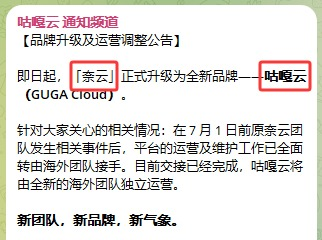

🇨🇳 [中文](README.md) | 🇺🇸 [English](README_EN.md) | 🇷🇺 Русский | 🇮🇷 [فارسی](README_FA.md)

# Официальный сайт GugaCloud VPN (обновлено 8 ноября 2026)

Официальный сайт GugaCloud VPN<br>

`VPN-сервис NaiYun провёл ребрендинг и теперь работает под новым названием GugaCloud.`

Новый адрес 01: [user.guga.cloud](https://to.iix.im/gu01)<br>
Новый адрес 02: [user.gugavpn.com](https://to.iix.im/gu02)<br>
Официальный сайт 01: [user.gugayun.com](https://to.iix.im/gu03)<br>
Официальный сайт 02: [user.gugavpn.one](https://to.iix.im/gu04)<br>
Постоянный адрес: [guga.cloud](https://guga.cloud)<br>

## Официальное объявление

---



---

Лучшие VPN-сервисы и прокси-серверы 2026 года: [https://github.com/jdnei/JiChangTuiJian](https://github.com/jdnei/JiChangTuiJian)<br>

## Telegram-сообщество VPN #AD

[Группа розыгрышей VPN](https://331024.de/archives/choujiang) | [Чат VPN](https://331024.de/archives/choujiang) | [Группа тестирования VPN](https://331024.de/archives/choujiang)<br>

[https://331024.de/archives/choujiang](https://331024.de/archives/choujiang)

## Описание

GugaCloud — профессиональный сервис оптимизации сетевых маршрутов, располагающий 86 глобальными ~~точками доступа и серверами с домашними IP-адресами в [США](https://github.com/jdnei/naiyun#1%E7%BE%8E%E5%9B%BD), [Гонконге](https://github.com/jdnei/naiyun#2%E9%A6%99%E6%B8%AF), [Тайване](https://github.com/jdnei/naiyun#3%E5%8F%B0%E6%B9%BE), [Японии](https://github.com/jdnei/naiyun#4%E6%97%A5%E6%9C%AC), [Южной Корее](https://github.com/jdnei/naiyun#5%E9%9F%A9%E5%9B%BD) и Малайзии~~.

Сервис предназначен для обеспечения стабильного и быстрого международного интернет-соединения, необходимого для удалённой работы, поиска зарубежных академических материалов и просмотра потокового видео.

## Пригласительный код

`При регистрации с этим пригласительным кодом можно бесплатно получить пробную подписку на 10 дней с 50 ГБ трафика.`

```bash
QPB5cCmr
```

## Промокод / Код скидки

`Скидка 30% на все тарифы в период акции, приуроченной к Празднику середины осени и Национальному дню Китая.`

```bash
MIDAUTUMN2026
```

После окончания бесплатного пробного периода новые пользователи могут один раз воспользоваться промокодом при покупке своей первой годовой подписки.

Стоимость годовой подписки указана как ~~¥168 в год~~, а после применения скидки — ¥XX в год. Акция позволяет приобрести один год обслуживания по сниженной цене.


## Тарифные планы

| Тариф | Цена | Период оплаты | Месячный / Общий трафик | Срок действия | Устройства | Максимальная скорость | Выделенные линии | Разблокировка стриминга | Серверные стойки в дата-центре | Передача аккаунта другим лицам | Примечания |
|---|---|---|---|---|---|---|---|---|---|---|---|
| Basic / Базовый (специальное предложение) | ¥168.00 | Ежегодно | 168 ГБ | 1 год | 5 | 5000 Мбит/с | Доступны | Поддерживается | Есть | Запрещена | Трафик автоматически обновляется в дату оформления заказа |
| Pro / Продвинутый | ¥32.30 | Ежемесячно | 388 ГБ | 1 месяц | 5 | 5000 Мбит/с | Доступны | Поддерживается | Есть | Запрещена | Трафик автоматически обновляется в дату оформления заказа |
| Max / Профессиональный | ¥49.30 | Ежемесячно | 788 ГБ | 1 месяц | 5 | 5000 Мбит/с | Доступны | Поддерживается | Есть | Запрещена | Трафик автоматически обновляется в дату оформления заказа |
| 280 ГБ с оплатой по объёму трафика | ¥138.00 | Единовременно | 280 ГБ | Без ограничения срока | 5 | 5000 Мбит/с | Доступны | Поддерживается | Есть | Запрещена | Действует до полного расходования трафика; несколько покупок нельзя объединить |
| 680 ГБ с оплатой по объёму трафика | ¥258.00 | Единовременно | 680 ГБ | Без ограничения срока | 5 | 5000 Мбит/с | Доступны | Поддерживается | Есть | Запрещена | Действует до полного расходования трафика; несколько покупок нельзя объединить |

## Преимущества

**Глобальное покрытие:** 86 точек присутствия сети (PoP) по всему миру, включая Юго-Восточную Азию, Европу, Северную Америку и некоторые редко представленные регионы.<br>

**Сеть корпоративного уровня:** Использование технологии международных выделенных каналов Global Accelerator с обеспечением высокой доступности узлов в соответствии с SLA.<br>

**Поддержка видео сверхвысокой чёткости:** Оптимизация передачи потокового видео в форматах 4K/8K с минимальной задержкой.<br>

## 📊 Тестирование производительности и анализ

#### 1. Тест скорости в вечерние часы пик


#### 2. Отчёт о разблокировке стриминговых сервисов


#### 3. Анализ входных и выходных узлов


#### 4. Анализ репутации и чистоты домашних IP-адресов

##### 4.1 США


##### 4.2 Гонконг


##### 4.3 Тайвань


##### 4.4 Япония


##### 4.5 Южная Корея


